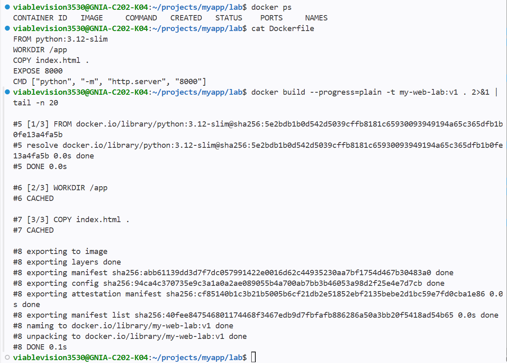
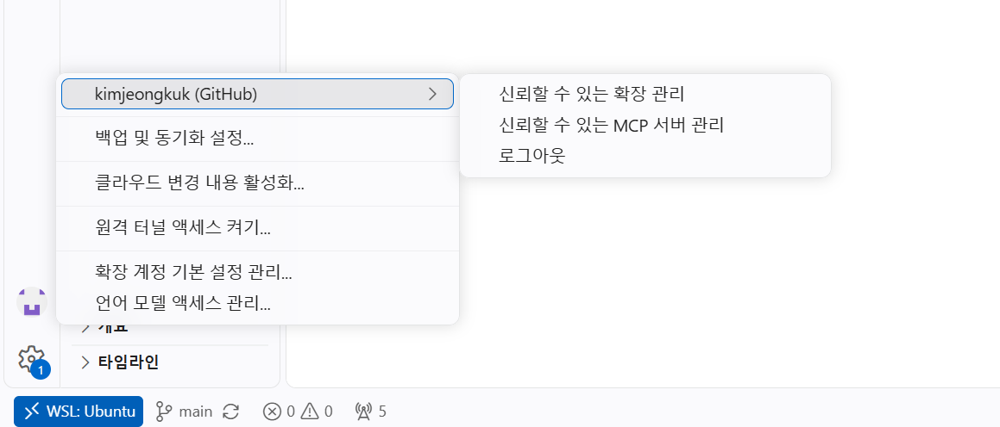

# 개발 워크스테이션 구축 미션 결과 보고서

## 1. 프로젝트 개요

- **목표:** 터미널(CLI), Docker, Git/GitHub로 개발 워크스테이션을 직접 구축하고, "내 컴퓨터에서만 되는" 문제를 줄이는 **재현 가능한 실행 환경**을 만든다.
- **수행 범위:** 터미널로 디렉토리·권한 정리 → Docker 설치/점검 → 컨테이너 실행/관리 → Dockerfile로 웹 서버 컨테이너화 → 포트 매핑 접속 확인 → 바인드 마운트/볼륨 검증 → Git 설정 및 GitHub 연동.
- **핵심 원칙:** 이미지와 컨테이너의 분리, 격리된 실행 환경, 포트·스토리지 연결 방식을 실행 결과(로그/접속/데이터 유지)로 확인한다.

## 2. 실행 환경

| 항목 | 값 |
|---|---|
| OS / Shell | Windows + WSL2 Ubuntu / bash |
| 터미널 | VSCode 통합 터미널 (WSL: Ubuntu) |
| Docker | Docker Desktop, `Docker version 29.9.3, build 5457199` |
| Git | `git version 2.53.0` |
| 작업 경로 | `~/projects/myapp/lab` |

```bash
$ docker --version && git --version
Docker version 29.9.3, build 5457199
git version 2.53.0
```

### 2.1 디렉토리 구조와 설계 기준

```text
~/projects/myapp/lab
├── Dockerfile        # 커스텀 이미지 정의
├── index.html        # 웹 서버가 서빙하는 정적 파일 (바인드 마운트 대상)
├── README.md         # 기술 문서
├── evidence/         # 상세 로그 (evidence.md)
└── images/           # 캡처 이미지
```

- **설계 기준:** 실습 코드·설정과 실행 증빙 로그를 분리하고, 불변 이미지/컨테이너와 마운트·볼륨 데이터를 구분해 재현성과 관리 편의성을 높였습니다.
- 상세 로그: [evidence/evidence.md](evidence/evidence.md)

## 3. 수행 체크리스트

- [x] 터미널 기본 조작 (pwd / ls -la / cd / mkdir / touch / cp / mv / rm / cat)
- [x] 권한 변경 실습 (파일 1, 디렉토리 1, 전/후 비교)
- [x] Docker 버전 확인
- [x] `docker info` 데몬 점검
- [x] 이미지/컨테이너 목록 (`docker images`, `docker ps`, `docker ps -a`, `docker stop`)
- [x] `docker logs`, `docker stats`
- [x] hello-world 실행
- [x] ubuntu 컨테이너 실행 및 명령 수행
- [x] attach / exec 차이 관찰·정리
- [x] Dockerfile 커스텀 이미지 빌드/실행
- [x] 포트 매핑 접속 (8080, 8081 두 포트)
- [x] 바인드 마운트 반영 (전/후)
- [x] Docker 볼륨 영속성 (생성 → 연결 → 컨테이너 삭제 → 재확인)
- [x] Git 설정 (`git config --list`, 기본 브랜치 main) + GitHub 원격 연동 (`git remote -v`, `git push`)
- [x] VSCode GitHub 로그인 및 저장소 연동
- [ ] (선택) Docker Compose 등 보너스

## 3.1 검증 방법과 결과 위치

| 항목 | 명령 | 확인한 내용 | 위치 |
|---|---|---|---|
| 터미널 조작 | `pwd` `ls -la` `cd` `mkdir` `touch` `cat` `cp` `mv` `rm` | 이동/생성/복사/삭제, 디렉토리 `-r` 오류 | [5.1](#51-터미널-기본-조작) |
| 권한 | `ls -l` → `chmod 600/700` → `ls -l` | 변경 전/후 권한 문자열 | [5.2](#52-권한-변경-전후) |
| Docker 점검 | `docker --version` `docker info` | 클라이언트/데몬 정상 응답 | [5.3](#53-docker-설치와-점검) |
| 컨테이너 실습 | `docker run hello-world` / ubuntu | 실행 성공, 내부 명령 수행 | [5.4](#54-hello-world-실행), [5.5](#55-ubuntu-컨테이너-실습) |
| attach/exec | `docker exec -it` / `docker attach` + `ps` | exec 후 Up, attach 후 Exited | [5.6](#56-attach와-exec-차이) |
| 운영 명령 | `images` `ps` `ps -a` `logs` `stats` `stop` | 이미지/컨테이너 상태, 로그, 리소스 | [5.7](#57-이미지와-컨테이너-운영-명령) |
| 커스텀 이미지 | `docker build -t my-web-lab:v1 .` | 빌드 성공 (`naming to ... done`) | [5.8](#58-dockerfile-커스텀-이미지) |
| 포트 매핑 | `-p 8080:8000` / `-p 8081:8000` + `curl -i` | 두 포트 모두 HTTP 200 | [5.9](#59-포트-매핑-접속) |
| 바인드 마운트 | `-v "$(pwd)/index.html:/app/index.html"` | 호스트 수정 전/후 응답 변화 | [5.10](#510-바인드-마운트) |
| 볼륨 영속성 | `docker volume create` / `-v lab-vol:/data` / `docker rm -f` | 컨테이너 삭제 후 데이터 유지 | [5.11](#511-볼륨-영속성) |
| Git/GitHub | `git config --list` `git remote -v` `git log` | 설정/원격 연결 확인 | [5.12](#512-git-설정과-github-연동) |

---

## 4. 개념 정리

### 4.1 절대경로와 상대경로
- **절대경로(`/...`, `~/...`)**: 현재 위치(`pwd`)와 무관하게 위치가 고정됩니다. 예: `~/projects/myapp/lab`
- **상대경로(`./...`, `evidence/...`)**: 현재 디렉토리 기준입니다. 클론한 위치가 달라도 구조만 같으면 동작해 이식성이 좋습니다. 예: `docker build -t my-web-lab:v1 .`의 빌드 컨텍스트 `.`

### 4.2 파일 권한 (rwx와 숫자 표기)
- `r`=4, `w`=2, `x`=1 이고, **소유자·그룹·기타** 순서로 세 자리를 씁니다.
- `7=rwx`, `6=rw-`, `5=r-x`, `4=r--`, `0=---`
- 예: `644` = `rw-r--r--`(소유자 읽기/쓰기, 나머지 읽기), `755` = `rwxr-xr-x`, `600` = 소유자만 읽기/쓰기, `700` = 소유자만 전체 권한.

### 4.3 이미지와 컨테이너
- **이미지**: 앱과 실행 환경을 담은 불변의 실행 템플릿(설계도).
- **컨테이너**: 이미지로부터 격리된 프로세스로 실행되는 인스턴스. 컨테이너 안의 변경은 삭제 시 함께 사라질 수 있습니다.

### 4.4 포트 매핑이 필요한 이유
컨테이너는 자체 네트워크 네임스페이스에서 실행되므로 내부 포트에서 대기해도 호스트에서 바로 접근할 수 없습니다. `-p <호스트포트>:<컨테이너포트>`로 호스트 요청을 컨테이너 포트로 전달합니다.

### 4.5 Docker 볼륨
- 컨테이너를 지우면 컨테이너 안의 데이터도 사라지지만, 볼륨은 Docker가 따로 관리하는 저장 공간이라 컨테이너를 삭제해도 데이터가 남습니다.
- 바인드 마운트는 **호스트의 특정 경로**를 컨테이너에 연결하고(개발 중 즉시 반영에 유리), 볼륨은 **Docker가 경로를 관리**합니다(데이터 영속성에 유리).

### 4.6 Git과 GitHub
- **Git**: 내 컴퓨터에서 변경 이력을 관리하는 로컬 버전 관리 도구.
- **GitHub**: Git 저장소를 원격에 호스팅하고 협업(PR, 이슈 등)을 지원하는 플랫폼.

---

## 5. 수행 로그와 증거

### 5.1 터미널 기본 조작

```bash
$ pwd
/home/user/e1-1
$ mkdir test-1
$ ls -la
total 56
drwxr-xr-x 5 user user  4096 Nov 10 14:45 .
...
-rw-r--r-- 1 user user 36081 Nov 10 14:21 README.md
drwxr-xr-x 2 user user  4096 Nov 10 14:45 test-1
$ cp test-1 test-2
cp: -r not specified; omitting directory 'test-1'     # 디렉토리는 -r 필요
$ mv test-1 test-2
$ cp -r test-2 test-3
$ rm test-2
rm: cannot remove 'test-2': Is a directory              # 디렉토리는 -r 필요
$ rm -r test-2
$ ls
README.md  README1.md  evidence  test-3
```

파일 내용 확인(`cat`)과 빈 파일 생성(`touch`):

```bash
$ touch empty.txt
$ echo "hello codyssey" > note.txt
$ cat note.txt
hello codyssey
$ ls -la
total 72
drwxr-xr-x 6 user user  4096 Nov 23 20:12 .
drwxr-xr-x 7 user user  4096 Nov 19 19:03 ..
drwxr-xr-x 7 user user  4096 Nov 23 20:11 .git
-rw-r--r-- 1 user user   146 Nov 23 19:38 Dockerfile
-rw-r--r-- 1 user user 26679 Nov 23 20:10 README.md
-rw-r--r-- 1 user user     0 Nov 23 20:12 empty.txt
drwxr-xr-x 2 user user  4096 Nov 23 18:53 evidence
drwxr-xr-x 2 user user  4096 Nov 23 20:10 images
-rw-r--r-- 1 user user    33 Nov 23 19:43 index.html
-rw------- 1 user user     0 Nov 21 10:05 my_file.txt
-rw-r--r-- 1 user user    15 Nov 23 20:12 note.txt
drwxr-xr-x 2 user user  4096 Nov 19 15:03 perm_dir
```

디렉토리 이동(`cd`):

```bash
$ cd evidence && pwd
/home/user/projects/myapp/lab/evidence
$ cd .. && pwd
/home/user/projects/myapp/lab
```

### 5.2 권한 변경 전후

**디렉토리**

```bash
$ chmod 755 perm_dir
$ ls -ld perm_dir
drwxr-xr-x 2 user user 4096 Nov 19 15:03 perm_dir
$ chmod 700 perm_dir
$ ls -ld perm_dir
drwx------ 2 user user 4096 Nov 19 15:03 perm_dir
```

**파일**
```bash
$ chmod 644 my_file.txt
$ ls -l my_file.txt
-rw-r--r-- 1 user user 0 Nov 21 10:05 my_file.txt     # 변경 전 (644)
$ chmod 600 my_file.txt
$ ls -l my_file.txt
-rw------- 1 user user 0 Nov 21 10:05 my_file.txt     # 변경 후 (600)
```

| 대상 | 변경 전 | 변경 후 |
|---|---|---|
| `my_file.txt` | `644` (`-rw-r--r--`) | `600` (`-rw-------`) |
| `perm_dir` | `755` (`drwxr-xr-x`) | `700` (`drwx------`) |

### 5.3 Docker 설치와 점검

```bash
$ docker --version
Docker version 29.9.3, build 5457199

$ docker info | sed -n '/^Server:/,$p' | head -n 20
Server:
 Containers: 6
  Running: 3
  Paused: 0
  Stopped: 3
 Images: 4
 Server Version: 29.9.3
 Storage Driver: overlayfs
  driver-type: io.containerd.snapshotter.v1
 Logging Driver: local
 Cgroup Driver: cgroupfs
 Cgroup Version: 2
 Plugins:
  Volume: local
  Network: bridge host ipvlan macvlan null overlay
  Log: awslogs fluentd gcplogs gelf journald json-file local splunk syslog
 CDI spec directories:
  /etc/cdi
  /var/run/cdi
 Discovered Devices:
```

- `Server:` 항목이 응답하므로 Docker 데몬(엔진)이 정상 동작 중입니다.
- 클라이언트와 서버 버전이 모두 `29.9.3`으로 일치합니다.

### 5.4 hello-world 실행

```bash
$ docker run --rm hello-world

Hello from Docker!
This message shows that your installation appears to be working correctly.

To generate this message, Docker took the following steps:
 1. The Docker client contacted the Docker daemon.
 2. The Docker daemon pulled the "hello-world" image from the Docker Hub.
    (amd64)
 3. The Docker daemon created a new container from that image which runs the
    executable that produces the output you are currently reading.
 4. The Docker daemon streamed that output to the Docker client, which sent it
    to your terminal.

To try something more ambitious, you can run an Ubuntu container with:
 $ docker run -it ubuntu bash

Share images, automate workflows, and more with a free Docker ID:
 https://hub.docker.com/

For more examples and ideas, visit:
 https://docs.docker.com/get-started/
```

### 5.5 ubuntu 컨테이너 실습

컨테이너를 실행해 내부에서 `ls`, `whoami`, `echo`를 수행했습니다.

```bash
$ docker run --rm ubuntu bash -c 'ls; whoami; echo "codyssey mission"'
bin
boot
dev
etc
home
lib
lib64
media
mnt
opt
proc
root
run
sbin
srv
sys
tmp
usr
var
root
codyssey mission
```

### 5.6 attach와 exec 차이

`docker exec`는 실행 중인 컨테이너에 새 셸 프로세스를 띄워 접속합니다.

```bash
$ docker run -d --name exec-demo ubuntu sleep infinity
555637967eb1e05c4371d7a32c650c52f998bcab9c055e968767cc8dbc7e6059
$ docker exec -it exec-demo bash
root@555637967eb1:/# echo hello-from-exec
hello-from-exec
root@555637967eb1:/# exit
exit
$ docker ps --filter name=exec-demo
CONTAINER ID   IMAGE    COMMAND            CREATED          STATUS          PORTS   NAMES
555637967eb1   ubuntu   "sleep infinity"   27 seconds ago   Up 27 seconds           exec-demo
```

`docker attach`는 컨테이너의 메인 프로세스(PID 1)에 직접 붙습니다.

```bash
$ docker run -dit --name attach-demo ubuntu bash
04cae699bf5b93a8491e38f4ea64f3b3da3dbdbdc1658cd303b471cdc79c49d0
$ docker attach attach-demo
root@04cae699bf5b:/# echo hello-from-attach
hello-from-attach
root@04cae699bf5b:/# exit
exit
$ docker ps -a --filter name=attach-demo
CONTAINER ID   IMAGE    COMMAND   CREATED          STATUS                     PORTS   NAMES
04cae699bf5b   ubuntu   "bash"    20 seconds ago   Exited (0) 6 seconds ago           attach-demo
```

| 구분 | `docker exec` | `docker attach` |
|---|---|---|
| 붙는 대상 | 실행 중인 컨테이너에 **새 프로세스** 생성 | 컨테이너의 **메인 프로세스(PID 1)** |
| `exit` 후 컨테이너 | 유지됨 (`Up`) | 종료됨 (`Exited (0)`) |
| 용도 | 운영 중 컨테이너 내부 점검 | 메인 프로세스의 입출력 확인 |

### 5.7 이미지와 컨테이너 운영 명령

```bash
$ docker images
IMAGE                ID             DISK USAGE   CONTENT SIZE   EXTRA
hello-world:latest   1e4c05b897a7       25.9kB         9.49kB   U
my-web-lab:v1        40fee8475468        177MB         43.3MB   U
my-web:1.0           af3a6422bf29        177MB         43.3MB
ubuntu:latest        d66b366dac61        163MB         45.9MB   U

$ docker ps
CONTAINER ID   IMAGE           COMMAND                  CREATED          STATUS          PORTS                                         NAMES
361aa0e576c0   my-web-lab:v1   "python -m http.serv…"   17 minutes ago   Up 17 minutes   0.0.0.0:8082->8000/tcp, [::]:8082->8000/tcp   bind-test
a803ceea632d   my-web-lab:v1   "python -m http.serv…"   23 minutes ago   Up 23 minutes   0.0.0.0:8081->8000/tcp, [::]:8081->8000/tcp   my-web-8081
1974658bf4a6   my-web-lab:v1   "python -m http.serv…"   25 minutes ago   Up 25 minutes   0.0.0.0:8080->8000/tcp, [::]:8080->8000/tcp   my-web-8080

$ docker logs bind-test
172.17.0.1 - - [23/Nov/2026 10:43:13] "GET / HTTP/1.1" 200 -
172.17.0.1 - - [23/Nov/2026 10:43:23] "GET / HTTP/1.1" 200 -

$ docker stats --no-stream
CONTAINER ID   NAME          CPU %   MEM USAGE / LIMIT     MEM %   NET I/O           BLOCK I/O         PIDS
361aa0e576c0   bind-test     0.01%   17.02MiB / 15.25GiB   0.11%   1.96kB / 1.45kB   0B / 1.93MB       1
a803ceea632d   my-web-8081   0.01%   16.51MiB / 15.25GiB   0.11%   1.82kB / 833B     0B / 1.93MB       1
1974658bf4a6   my-web-8080   0.04%   28.34MiB / 15.25GiB   0.18%   2.94kB / 833B     24.2MB / 1.93MB   1

$ docker stop bind-test
bind-test

$ docker ps -a
CONTAINER ID   IMAGE           COMMAND                  CREATED          STATUS                        NAMES
361aa0e576c0   my-web-lab:v1   "python -m http.serv…"   17 minutes ago   Exited (137) 1 second ago     bind-test
a803ceea632d   my-web-lab:v1   "python -m http.serv…"   24 minutes ago   Up 24 minutes                 my-web-8081
1974658bf4a6   my-web-lab:v1   "python -m http.serv…"   25 minutes ago   Up 25 minutes                 my-web-8080
b1e98e784010   93eb0c85b703    "python -m http.serv…"   2 days ago       Exited (255) 29 minutes ago   web-lab-test
c835ba128675   ubuntu          "bash"                   4 days ago       Exited (0) 4 days ago         my-ubuntu
920afec8802e   hello-world     "/hello"                 4 days ago       Exited (0) 4 days ago         pedantic_darwin
```

- `docker ps`에서 세 컨테이너의 포트 매핑(`8080/8081/8082 → 8000`)을 확인했습니다.
- `docker logs`의 `GET / ... 200` 두 줄은 바인드 마운트 전/후에 보낸 `curl` 요청입니다.
- `docker stop bind-test` 후 `docker ps -a`에서 `bind-test`가 `Exited`로 바뀐 것을 확인했습니다. `Exited (137)`은 `docker stop`의 종료 신호에 `python -m http.server`가 제때 응답하지 않아 강제 종료된 코드입니다.

### 5.8 Dockerfile 커스텀 이미지

- **선택 방식:** (B) Linux/Python 베이스 이미지 + 기능 추가
- **베이스 이미지:** `python:3.12-slim`

```bash
$ cat Dockerfile
FROM python:3.12-slim
WORKDIR /app
COPY index.html .
EXPOSE 8000
CMD ["python", "-m", "http.server", "8000"]
```

| 커스텀 포인트 | 목적 |
|---|---|
| `FROM python:3.12-slim` | 가벼운 공식 Python 이미지를 베이스로 사용 |
| `WORKDIR /app` | 컨테이너 안의 작업 디렉토리를 `/app`으로 지정 |
| `COPY index.html .` | 호스트의 `index.html`을 `/app/index.html`로 복사해 서빙할 콘텐츠로 포함 |
| `EXPOSE 8000` | 컨테이너가 8000 포트를 사용함을 명시 |
| `CMD ["python", "-m", "http.server", "8000"]` | 컨테이너 시작 시 `/app`을 서빙하는 웹 서버 실행 |

```bash
$ docker build --progress=plain -t my-web-lab:v1 . 2>&1 | tail -n 20

#5 [1/3] FROM docker.io/library/python:3.12-slim@sha256:5e2bdb1b0d542d5039cffb8181c65930093949194a65c365dfb1b0fe13a4fa5b
#5 resolve docker.io/library/python:3.12-slim@sha256:5e2bdb1b0d542d5039cffb8181c65930093949194a65c365dfb1b0fe13a4fa5b 0.0s done
#5 DONE 0.0s

#6 [2/3] WORKDIR /app
#6 CACHED

#7 [3/3] COPY index.html .
#7 CACHED

#8 exporting to image
#8 exporting layers done
#8 exporting manifest sha256:abb61139dd3d7f7dc057991422e0016d62c44935230aa7bf1754d467b30483a0 done
#8 exporting config sha256:94ca4c370735e9c3a1a0a2ae089055b4a700ab7bb3b46053a98d2f25e4e7d7cb done
#8 exporting attestation manifest sha256:cf85140b1c3b21b5005b6cf21db2e51852ebf2135bebe2d1bc59e7fd0cba1e86 0.0s done
#8 exporting manifest list sha256:40fee847546801174468f3467edb9d7fbfafb886286a50a3bb20f5418ad54b65 0.0s done
#8 naming to docker.io/library/my-web-lab:v1 done
#8 unpacking to docker.io/library/my-web-lab:v1 done
#8 DONE 0.1s
```

- 마지막의 `naming to docker.io/library/my-web-lab:v1 done`으로 이미지가 만들어진 것을 확인했습니다. `CACHED`는 같은 내용으로 이전에 빌드한 레이어를 재사용했다는 뜻입니다.

### 5.9 포트 매핑 접속

호스트 8080, 8081 두 포트를 같은 컨테이너 포트(8000)로 연결해 접속했습니다.

```bash
$ docker run -d -p 8080:8000 --name my-web-8080 my-web-lab:v1
1974658bf4a65b43ee2eb58c4b1ea011c4ac1cd6ac68264fae5278e6eb55a409
$ curl -i http://localhost:8080
HTTP/1.0 200 OK
Server: SimpleHTTP/0.6 Python/3.12.16
Date: Mon, 23 Nov 2026 10:35:27 GMT
Content-type: text/html
Content-Length: 33
Last-Modified: Sat, 21 Nov 2026 01:05:40 GMT

<h1>Updated via Bind Mount!</h1>

$ docker run -d -p 8081:8000 --name my-web-8081 my-web-lab:v1
a803ceea632d5f86c513881b8c703baf9fda198fbd190e9f8c75d18743c64f14
$ curl -i http://localhost:8081
HTTP/1.0 200 OK
Server: SimpleHTTP/0.6 Python/3.12.16
Date: Mon, 23 Nov 2026 10:36:50 GMT
Content-type: text/html
Content-Length: 33
Last-Modified: Sat, 21 Nov 2026 01:05:40 GMT

<h1>Updated via Bind Mount!</h1>
```



### 5.10 바인드 마운트

호스트의 `index.html`을 컨테이너의 `/app/index.html`에 연결하고, 호스트에서 파일을 수정해 컨테이너를 다시 만들지 않고도 응답이 바뀌는지 확인했습니다.

```bash
$ echo '<h1>Before Bind Mount</h1>' > index.html
$ docker run -d -p 8082:8000 -v "$(pwd)/index.html:/app/index.html" --name bind-test my-web-lab:v1
361aa0e576c04e029ec85bc829b908938a1e6570e033697e5fcd782803451056
$ sleep 2
$ curl http://localhost:8082
<h1>Before Bind Mount</h1>
$ echo '<h1>Updated via Bind Mount!</h1>' > index.html
$ curl http://localhost:8082
<h1>Updated via Bind Mount!</h1>
```

### 5.11 볼륨 영속성

```bash
$ docker volume create lab-vol
lab-vol

$ docker run -d --name vol-check-ctr -v lab-vol:/data ubuntu sleep infinity
3c61bf8f9e38efed905ebde3c8876308c5e4d9c9d2c907a4a82ea130311d0412

$ docker exec vol-check-ctr bash -c 'echo persist-check-2026 > /data/note.txt'

$ docker exec vol-check-ctr bash -c 'ls -la /data && cat /data/note.txt'
total 12
drwxr-xr-x 2 root root 4096 Nov 21 02:45 .
drwxr-xr-x 1 root root 4096 Nov 23 11:03 ..
-rw-r--r-- 1 root root   19 Nov 23 11:03 note.txt
persist-check-2026

$ docker rm -f vol-check-ctr
vol-check-ctr

$ docker ps -a --filter name=vol-check-ctr
CONTAINER ID   IMAGE     COMMAND   CREATED   STATUS    PORTS     NAMES

$ docker run --rm -v lab-vol:/data ubuntu bash -c 'ls -la /data && cat /data/note.txt'
total 12
drwxr-xr-x 2 root root 4096 Nov 21 02:45 .
drwxr-xr-x 1 root root 4096 Nov 23 11:03 ..
-rw-r--r-- 1 root root   19 Nov 23 11:03 note.txt
persist-check-2026
```

- 삭제 전: `vol-check-ctr`에서 `/data/note.txt`에 `persist-check-2026`을 저장했습니다.
- 삭제 후: `docker ps -a --filter`가 빈 목록이라 컨테이너가 사라진 것을 확인했습니다.
- 재확인: 새 컨테이너가 같은 `lab-vol`을 연결하자 파일과 내용이 그대로 남아 있었습니다.

### 5.12 Git 설정과 GitHub 연동

```bash
$ git config --global user.name "kimjeongkuk"
$ git config --global user.email "<masked>"      # 이메일은 마스킹
$ git config --global init.defaultBranch main
$ git config --list | grep -E "user\.|init\.defaultbranch"
user.name=kimjeongkuk
user.email=<masked>
init.defaultbranch=main
```

```bash
$ git remote -v
origin  https://github.com/kimjeongkuk/e1-1.git (fetch)
origin  https://github.com/kimjeongkuk/e1-1.git (push)
```

최근 커밋 이력:

```bash
$ git log --oneline -n 5
1209b05 Docs: README 전체 정리 및 증적 보완
f8a110d Docs: README TODO 정리 및 증적 반영
28615b8 Docs: README TODO 정리 및 증적 보완
5115c20 Docs: 실행 증적 및 로그 추가
b51af00 Update README with completed Docker tasks
```

```bash
$ git push origin main
Writing objects: 100% (4/4), 757 bytes | 757.00 KiB/s, done.
To https://github.com/kimjeongkuk/e1-1.git
   5115c20..28615b8  main -> main
```



---

## 6. 트러블슈팅

### 6.1 컨테이너 이름 충돌 (`Conflict. The container name is already in use`)
| 단계 | 내용 |
|---|---|
| 문제 | `docker run --name bind-test ...` 실행 시 `Conflict. The container name "/bind-test" is already in use` 오류 |
| 원인 가설 | 같은 이름의 컨테이너가 이미 존재(종료 상태 포함)하면 같은 이름으로 새로 만들 수 없다 |
| 확인 | `docker ps -a`로 `bind-test`가 남아 있는지 확인 |
| 해결 | `docker rm -f bind-test`로 삭제 후 같은 명령 재실행하여 성공 |

```bash
$ docker run -d -p 8082:8000 -v "$(pwd)/index.html:/app/index.html" --name bind-test my-web-lab:v1
docker: Error response from daemon: Conflict. The container name "/bind-test" is already in use by container "33fabe0b69832dbcf6acd79dbb4b0be1d3dcd04f69b1c9cf366282a5a95b6880". You have to remove (or rename) that container to be able to reuse that name.
$ docker rm -f bind-test
bind-test
```

### 6.2 `cp` / `rm` 디렉토리 오류
| 단계 | 내용 |
|---|---|
| 문제 | `cp: -r not specified; omitting directory`, `rm: cannot remove 'test-2': Is a directory` |
| 원인 가설 | 디렉토리는 재귀 옵션 없이 복사·삭제할 수 없다 |
| 확인 | `cp --help`, `rm --help`에서 `-r` 옵션 확인 |
| 해결 | `cp -r`, `rm -r`로 재실행하여 성공 (출력은 [5.1](#51-터미널-기본-조작)) |

### 6.3 포트 충돌 확인·해제 절차 (참고)
같은 호스트 포트로 컨테이너를 또 실행하면 시작에 실패합니다. 점유 여부를 확인하고 비우는 방법입니다.

```bash
docker ps --filter "publish=8080"     # 8080을 쓰는 컨테이너 찾기
ss -ltn | grep 8080                   # 호스트에서 8080 대기 상태 확인
docker stop <컨테이너명>               # 포트 비우기 (또는 -p 8083:8000 처럼 다른 포트 사용)
```

---

## 7. 재현 방법

```bash
git clone https://github.com/kimjeongkuk/e1-1.git
cd e1-1

# 빌드 및 포트 매핑 접속
docker build -t my-web-lab:v1 .
docker run -d --name my-web-8080 -p 8080:8000 my-web-lab:v1
curl -i http://localhost:8080

# 바인드 마운트 (호스트 index.html 수정이 바로 반영됨)
docker run -d -p 8082:8000 -v "$(pwd)/index.html:/app/index.html" --name bind-test my-web-lab:v1
echo '<h1>Updated via Bind Mount!</h1>' > index.html
curl http://localhost:8082

# 볼륨 영속성
docker volume create lab-vol
docker run -d --name vol-check-ctr -v lab-vol:/data ubuntu sleep infinity
docker exec vol-check-ctr bash -c 'echo persist-check-2026 > /data/note.txt'
docker rm -f vol-check-ctr
docker run --rm -v lab-vol:/data ubuntu cat /data/note.txt
```

- 컨테이너 포트 `8000`은 `Dockerfile`의 `EXPOSE 8000`, `CMD` 기준입니다.
- 경로(`~/projects/myapp/lab`)는 개인 PC 기준이므로, 클론한 디렉토리에서 실행하면 동일하게 동작합니다.
- Windows에서는 WSL2 Ubuntu 터미널에서 실행하고, Docker Desktop을 먼저 켜 둔 상태여야 `docker` 명령이 동작합니다. `sudo`가 제한된 환경에서는 Docker Desktop(또는 OrbStack)을 사용합니다.